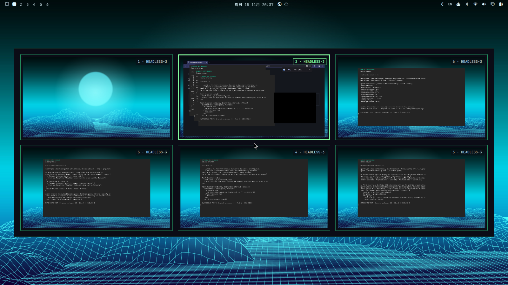

# Omarchy Switchboard

[简体中文](README.md) | **English**

## Introduction

Omarchy Switchboard is an application, window, and workspace switcher for [Omarchy](https://github.com/omacom/omarchy). It runs inside the existing `omarchy-shell` and provides an application icon list, previews of windows within an application, and a workspace overview to help you move between tasks.

- **Switch applications**: `Alt+Tab` lists applications on the current workspace in most recently used order. Each application has one icon, with a count badge for multiple windows; confirming opens its most recently used window.
- **Switch windows within an application**: `` Alt+` `` opens a bubble with live window previews for the current application. You can also use it on the highlighted application in the icon list.
- **Switch workspaces**: `Win+Tab` shows a grid for the monitor focused when the panel opens. It includes the first five numbered slots and other numeric workspaces actually on that monitor. Empty slots show the wallpaper and are created only on confirmation. Visiting workspaces moved from another monitor or merged after a monitor disconnect are included.
- **Match your desktop**: The panel follows Omarchy's colors, fonts, corner radius, and Chinese / English language setting. Live window capture runs only for visible cards and stops when the panel closes.

Local workspace badges follow Omarchy's `1–9, 0` numbering, with `0` representing the tenth slot. Visiting workspaces outside the monitor's numbering range display `↳ global ID` to avoid duplicate badges. The grid adapts to the number of workspaces; above 12 entries, it uses four columns with scrolling.

### Screenshots

**Win+Tab: Workspace overview with live window previews and wallpaper for empty slots.**



This is a development preview. Ordinary named workspaces such as `a` or `coding` are currently excluded; see [known issues](docs/known-issues.md). A window image LRU cache and a full GPU / memory budget have yet to be implemented. See the [desktop acceptance checklist](tests/integration/README.md) and [validation records](docs/development-validation.md) for compatibility and the scope of actual testing.

## Keyboard Shortcuts

Enable these shortcuts with `./scripts/install.sh --bindings`. `Win` is Hyprland's `Super` key. The backtick is the `` ` / ~ `` key on your keyboard.

| Shortcut | Action |
| --- | --- |
| `Win+Tab` | Select the next workspace on the current monitor; release Win to confirm |
| `Win+Shift+Tab` | Select the previous workspace on the current monitor; release Win to confirm |
| `Alt+Tab` | Select the next application on the current workspace; release Alt to confirm |
| `Alt+Shift+Tab` | Select the previous application on the current workspace; release Alt to confirm |
| `` Alt+` `` | Select the next window within the application; release Alt to confirm |
| `` Alt+Shift+` `` | Select the previous window within the application; release Alt to confirm |

While a panel is open, you can also use:

| Key / Input | Action |
| --- | --- |
| `Tab` / `Shift+Tab` | Cycle through candidates; if the window bubble is open, close it and switch applications |
| Arrow keys | Navigate rows and columns, including while holding Win / Alt; in a grid, left / right stay within the row, up / down keep the column, and selection stays put at an edge |
| `Enter` / Mouse click | Confirm the selection |
| `Esc` | Cancel and restore the window focus from before the panel opened |
| Mouse wheel | Scroll when the content exceeds the panel size |

The `Alt+Tab` icon panel appears after about 100 ms; selection and confirmation still respond immediately during a quick tap. The application list and window bubble stay closed when the current workspace has no eligible applications. Panels opened from the command line use explicit confirmation and do not require a held modifier.

Enabling bindings takes over the six combinations above. `` Win+` `` and `` Win+Shift+` `` keep their Quake console bindings, and `Win+Ctrl+Tab` keeps its existing binding. The backtick uses a physical keycode and supports the dead key in US international layouts. For a custom layout, edit the repository's `bindings.lua` and reinstall.

## Installation

### Requirements

To install from source, you need:

- A running Omarchy / Hyprland Lua session, with matching Quickshell, Qt 6, and Omarchy shell sources.
- Git, Node.js **22.12 or later**, npm, Python 3, Lua (`lua`, `luac`), and Bash.
- The Qt tools `qmllint` and `qmltestrunner`, plus the `omarchy`, `omarchy-shell`, and `hyprctl` commands.
- ImageMagick for wallpaper thumbnails, installed by default in Omarchy.

Node.js and npm are used only for building and checking. At runtime, the plugin uses QML, precompiled JavaScript ESM, and Lua. Python 3 and ImageMagick generate the wallpaper cache in a separate process.

### Install from Source

```bash
git clone https://github.com/JessieChan0730/omarchy-switchboard.git
cd omarchy-switchboard
npm ci
./scripts/install.sh
```

The script runs the full checks, then deploys and enables the plugin at `~/.config/omarchy/plugins/jessie.switchboard/`. The first installation preserves your existing shortcuts by default. To use the shortcuts above, run:

```bash
./scripts/install.sh --bindings
```

The installer backs up your configuration and any existing plugin with the same ID, reloads Hyprland and the plugin, and verifies the running instance's `buildId` and readiness. A failed deployment rolls back its changes.

### Check and Try the Plugin

```bash
# Check readiness, build ID, and binding mode
omarchy-shell jessie.switchboard status

# Application list
omarchy-shell shell summon jessie.switchboard '{"mode":"window"}'

# Window previews for the current application
omarchy-shell shell summon jessie.switchboard '{"mode":"app-windows"}'

# Workspace overview for the current monitor
omarchy-shell shell summon jessie.switchboard '{"mode":"workspace"}'
```

Use Tab / arrow keys to select, Enter to confirm, and Esc to cancel. Add `"direction":-1` for an initial reverse selection, for example `'{"mode":"workspace","direction":-1}'`. Opening a panel advances the selection once in the requested direction.

## Updating

Run these commands in your existing checkout:

```bash
git pull --ff-only
npm ci
./scripts/install.sh
```

Reinstalling updates the plugin while preserving your previous binding mode and settings. Each deployment uses a separate `runtime/<buildId>/` path and reports success only after verifying the new instance.

To change the binding mode, use `./scripts/install.sh --bindings` to enable shortcuts, or run the following to restore the original bindings while keeping the plugin available through commands:

```bash
./scripts/install.sh --no-bindings
```

## Uninstallation

Run from the repository root:

```bash
./scripts/uninstall.sh
```

Uninstallation removes this plugin's entry and the managed Lua include, preserving other plugins, settings, and shortcuts added afterward. If a plugin with the same ID existed before installation, its directory and original entry are restored while retaining settings fields modified afterward. Repeated uninstallation is safe.

Backups and installation records remain at `${XDG_STATE_HOME:-~/.local/state}/omarchy-switchboard/` for manual inspection.

To disable the plugin temporarily, run `omarchy plugin disable jessie.switchboard`. With bindings enabled, Tab combinations fall back to direct cycling once the runtime lease is cleared or expires after the plugin becomes unavailable. Use `--no-bindings` or the uninstall script to restore the original bindings immediately.

## Development

### Workflow

The stack is **QML + TypeScript + Lua**: QML handles the UI and input, TypeScript handles candidates, sorting, and session logic, and Lua handles global shortcuts. TypeScript compiles to `.mjs` modules loaded by Qt; application logic does not depend on Node.js or browser APIs.

After meeting the installation requirements:

```bash
npm ci
npm run dev
```

`npm run dev` watches the source and updates `dist/plugin/` inside the repository. It does not deploy automatically. After making changes, run `./scripts/install.sh` to check and deploy to your current desktop, preserving the existing binding mode.

| Command | Purpose |
| --- | --- |
| `npm run typecheck` | Check application TypeScript and build scripts |
| `npm run build` | Type-check, generate ESM, and assemble `dist/plugin/` |
| `npm run dev` | Watch sources and rebuild |
| `npm run lint:qml` | Check QML and Omarchy / Quickshell imports |
| `npm run test:qt` | Test release ESM and actual component layouts in Qt |
| `npm run validate` | Validate the Omarchy manifest |
| `npm run check` | Run the full build, QML / Qt / manifest checks, Lua / Bash syntax checks, and installer and wallpaper cache tests |

Set `QT_BIN_DIR` to choose a Qt tools directory or `OMARCHY_SHELL_DIR` to choose an Omarchy shell source directory. QML tooling metadata adjustments are written to the repository's `.cache/`.

## Acknowledgments

Thanks to these projects for the underlying capabilities and design references:

- [Omarchy](https://github.com/omacom/omarchy): Plugin host, themes, translations, and workspace bar.
- [Hyprland](https://github.com/hyprwm/Hyprland): Window, workspace, and monitor management, plus Lua / IPC interfaces.
- [Quickshell](https://quickshell.org/) and [Qt](https://www.qt.io/): QML UI, Wayland integration, and live window capture.
- [Orbit](https://github.com/rohan-patnaik/orbit): Reference for an Omarchy switcher, MRU ordering, and input interaction.
- [Hyprspace](https://github.com/KZDKM/Hyprspace): Design reference for workspace overviews and window layout previews.
- [Hyprshell](https://github.com/H3rmt/hyprshell): Reference for application icon matching, window switching, and configuration interaction.

## License

This project is licensed under the [MIT License](LICENSE). Copyright © 2026 Jessie.
