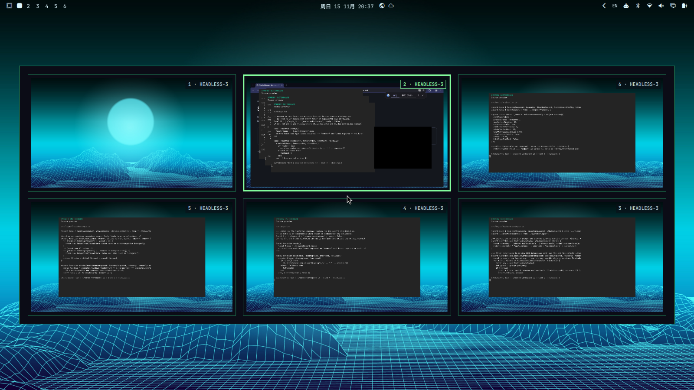

# Omarchy Switchboard

**简体中文** | [English](README.en.md)

## 插件简介

Omarchy Switchboard 是 [Omarchy](https://github.com/omacom/omarchy) 的应用、窗口与工作区切换插件，运行在现有的 `omarchy-shell` 中。它提供应用图标列表、同应用窗口预览和工作区概览，方便在多个任务之间快速切换。工作区角标沿用 Omarchy 的本屏 `1–9、0` 编号，`0` 表示第 10 个槽位；本屏编号段之外的来访工作区显示 `↳ 全局 ID`，避免重复角标。工作区较多时可滚动查看。

### 界面预览

**Win+Tab：工作区概览，包含实时窗口预览与空槽位壁纸。**



## 快捷键

通过 Omarchy 安装并启用插件后，以下切换快捷键默认生效。`Win` 指键盘上的 Windows 键。面板打开后，也可使用表中的按键和鼠标操作。

| 快捷键 / 操作 | 功能 |
| --- | --- |
| `Win+Tab` | 选择当前屏幕的下一个工作区，松开 Win 确认 |
| `Win+Shift+Tab` | 选择当前屏幕的上一个工作区，松开 Win 确认 |
| `Alt+Tab` | 选择当前工作区的下一个应用，松开 Alt 确认 |
| `Alt+Shift+Tab` | 选择当前工作区的上一个应用，松开 Alt 确认 |
| `Alt+~` | 选择同应用的下一个窗口，松开 Alt 确认 |
| `Alt+Shift+~` | 选择同应用的上一个窗口，松开 Alt 确认 |
| `Tab` / `Shift+Tab` | 面板打开时，正向 / 反向循环选择 |
| 方向键 | 面板打开时，按行列选择 |
| `Enter` / 鼠标点击 | 确认选择 |
| `Esc` | 取消选择，恢复打开前的窗口焦点 |
| 鼠标滚轮 | 内容超出面板时滚动查看 |

Alt+Tab 在每个应用图标下方居中显示应用名，过长时以省略号截断。高亮多窗口应用并停留 700ms 后，自动展开窗口预览，默认选中该应用最近使用的第一个窗口。继续按 `Alt+~` / `Alt+Shift+~` 可选择其他窗口；按 Tab 切到另一个应用时收起预览并重新计时，松开 Alt 激活所选窗口。

## 安装

### 通过 Omarchy 安装（推荐）

需要正在运行的 Omarchy / Hyprland Lua 会话，以及匹配的 Quickshell 和 Qt 6。运行时使用 Git、Python 3 和 ImageMagick，Omarchy 默认提供；**不需要 Node.js、npm 或现场编译**。

```bash
omarchy plugin add https://github.com/JessieChan0730/omarchy-switchboard.git --enable
```

插件安装到 `~/.config/omarchy/plugins/jessie.switchboard/`。首次安装默认启用切换快捷键，已有快捷键设置优先。停用、卸载插件或关闭插件快捷键后，会恢复原快捷键。

### 从源码安装（开发用途）

额外需要 Node.js **22.12 或更高版本**、npm、Lua（`lua`、`luac`）、Bash，以及 Qt 工具 `qmllint`、`qmltestrunner` 和 Omarchy shell 源码。

```bash
git clone https://github.com/JessieChan0730/omarchy-switchboard.git
cd omarchy-switchboard
npm ci
./scripts/install.sh
```

脚本运行完整检查后部署并启用本地开发构建。首次源码安装默认保留现有快捷键；需要使用上表快捷键时执行 `./scripts/install.sh --bindings`，恢复原快捷键时执行 `./scripts/install.sh --no-bindings`。重复部署保留当前快捷键模式和插件设置。

安装器会备份配置和已有同 ID 插件，清理旧版本的受管理 Lua include，重新加载 Hyprland 与插件，并核对运行实例的 `buildId` 和就绪状态；失败时回滚。它会拒绝覆盖 Git 安装，避免破坏 `.git` 和官方更新能力。

### 从旧源码安装迁移到 Git 安装

在源码仓库执行：

```bash
./scripts/migrate.sh
```

迁移脚本先备份，再卸载受管理的开发安装，通过官方 `plugin add` 安装 Git 仓库，并恢复插件设置和快捷键模式；失败时回滚。默认使用上述 GitHub URL，也可通过 `--url <Git URL>` 指定发布仓库。如果首次开发安装曾覆盖另一个同 ID 插件，脚本会要求先处理该原安装，避免丢失它。

## 检查与试用

```bash
# 查看插件和快捷键状态
omarchy-shell jessie.switchboard status

# 应用列表
omarchy-shell shell summon jessie.switchboard '{"mode":"window"}'

# 当前应用的窗口预览
omarchy-shell shell summon jessie.switchboard '{"mode":"app-windows"}'

# 当前屏幕的工作区概览
omarchy-shell shell summon jessie.switchboard '{"mode":"workspace"}'
```

`status` 中 `ready` 应为 `true`；启用快捷键时 `bindings` 也应为 `true`。命令打开后，使用 Tab / 方向键选择、Enter 确认、Esc 取消。

只使用命令调用、保留原快捷键时，在插件启用状态下执行：

```bash
omarchy-shell jessie.switchboard settings '{"bindingsEnabled":false}'

# 再次启用插件快捷键
omarchy-shell jessie.switchboard settings '{"bindingsEnabled":true}'
```

## 更新

Git 安装使用：

```bash
omarchy plugin update jessie.switchboard
```

更新后如需重新加载，执行：

```bash
omarchy restart shell
```

shell 重启本身不会下载新版本。修改 Git 安装目录可能影响快进更新，开发时应使用源码仓库。

源码开发安装在仓库中执行：

```bash
git pull --ff-only
npm ci
./scripts/install.sh
```

## 禁用与卸载

Git 安装和开发安装均可临时禁用、重新启用：

```bash
omarchy plugin disable jessie.switchboard
omarchy plugin enable jessie.switchboard
```

Git 安装通过官方命令卸载：

```bash
omarchy plugin remove jessie.switchboard
```

源码开发安装使用 `./scripts/uninstall.sh`，以恢复安装前的插件条目及同 ID 插件备份。卸载会保留其他插件、设置和后来添加的快捷键；重复卸载可安全执行。备份与安装记录保存在 `${XDG_STATE_HOME:-~/.local/state}/omarchy-switchboard/`。

## 开发

### 开发流程

技术栈为 **QML + TypeScript + Lua**：QML 负责界面和输入，TypeScript 负责候选、排序与会话逻辑，Lua 负责全局快捷键。TypeScript 编译为 Qt 可加载的 `.mjs`，业务代码不依赖 Node.js 或浏览器 API。

在满足安装环境要求后：

```bash
npm ci
npm run dev
```

`npm run dev` 监听源码并更新仓库中的 `dist/plugin/`，不会自动部署。完成修改后执行 `./scripts/install.sh`，由脚本检查并部署到当前桌面；已有安装保留当前快捷键模式。

| 命令 | 用途 |
| --- | --- |
| `npm run typecheck` | 检查业务 TypeScript 和构建脚本 |
| `npm run build` | 类型检查后生成 ESM 并组装 `dist/plugin/` |
| `npm run dev` | 监听源码并重新构建 |
| `npm run lint:qml` | 检查 QML 与 Omarchy / Quickshell 导入 |
| `npm run test:qt` | 在 Qt 中测试发布 ESM 和真实组件布局 |
| `npm run validate` | 校验构建产物的 Omarchy manifest |
| `npm run release` | 完整检查后生成 Git 发布目录与根 manifest |
| `npm run check:release` | 重新构建并核对发布文件与源码一致 |
| `npm run check` | 完整构建、QML / Qt / manifest 检查、Lua / Bash 语法及安装器与壁纸缓存测试 |

`QT_BIN_DIR` 可指定 Qt 工具目录，`OMARCHY_SHELL_DIR` 可指定 Omarchy shell 源码目录。QML 工具元数据的兼容处理写入仓库 `.cache/`。

### 准备 Git 发布

修改源码和 `manifest.source.json` 后执行：

```bash
npm run release
npm run check:release
```

`manifest.source.json` 是源清单；根目录的 `manifest.json` 和 `runtime/` 由发布脚本生成，应随源码一起提交到公开仓库的默认分支。`buildId` 是运行文件和源清单的内容哈希，同一份源码生成相同 ID。不要直接编辑 `runtime/`。发布脚本仅准备本地文件，不提交或推送 Git，也不自动申请市场收录。

GitHub Actions 会重新构建并检查发布文件是否过期，确认必需运行文件未被 Git 忽略，并执行安装器与 Lua 生命周期测试。完整 QML / Qt 检查需要 Omarchy 环境，通过本地 `npm run check` 执行。实际官方命令验收见[桌面集成说明](tests/integration/README.md)。

## 鸣谢

感谢以下项目提供基础能力与设计参考：

- [Omarchy](https://github.com/omacom/omarchy)：插件宿主、主题、翻译与工作区栏。
- [Hyprland](https://github.com/hyprwm/Hyprland)：窗口、工作区、显示器管理与 Lua / IPC 接口。
- [Quickshell](https://quickshell.org/) 与 [Qt](https://www.qt.io/)：QML 界面、Wayland 集成与实时窗口捕获。
- [Orbit](https://github.com/rohan-patnaik/orbit)：Omarchy 原生切换面板、MRU 与输入交互的参考。
- [Hyprspace](https://github.com/KZDKM/Hyprspace)：工作区概览与窗口布局预览的设计参考。
- [Hyprshell](https://github.com/H3rmt/hyprshell)：应用图标匹配、窗口切换与配置交互的参考。

## License

本项目采用 [MIT License](LICENSE)，版权归 © 2026 Jessie 所有。
